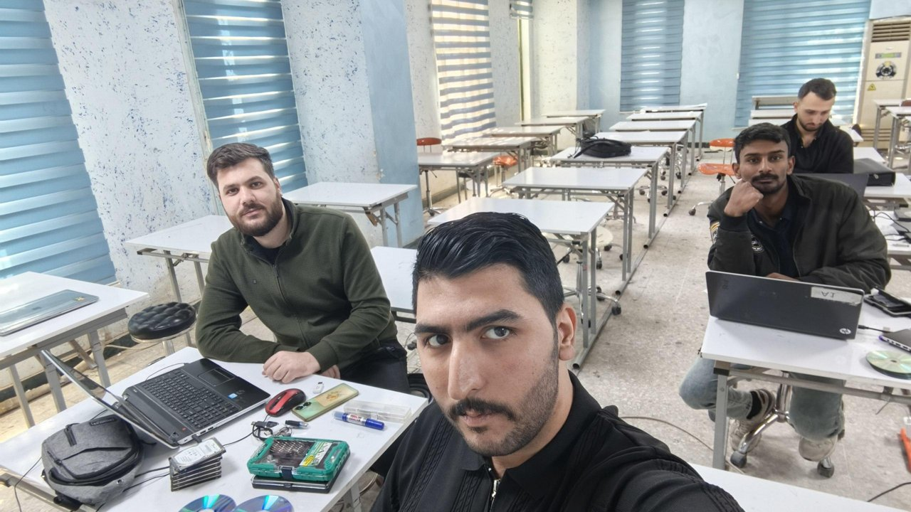

# ورشة صيانة وتأهيل الحاسبات المختبرية

نشاط من تنفيذ فريق **سايبر آي كيو (Cyber IQ)** — الجامعة العراقية، كلية الهندسة، قسم هندسة الشبكات والأمن السيبراني.

## نبذة

صيانة وتأهيل أجهزة الحاسوب المحمولة الخاصة بمختبرات القسم وإعادتها إلى الخدمة، بعمل تطوعي ضمن مدة مكثّفة.

## معلومات النشاط

| البند | التفصيل |
|---|---|
| عدد الأجهزة | 150 حاسبة محمولة |
| عدد المختبرات | 3 مختبرات |
| المدة | 3 إلى 4 أسابيع |
| ساعات العمل | يومياً من 8:00 صباحاً حتى 4:00 عصراً |
| عدد المنفّذين | 10 أعضاء |

## أعمال الصيانة

- **الهاردوير:** فحص المكونات ووحدات التخزين، استبدال وحدات التخزين وترقية RAM حسب الحاجة، معالجة الأعطال المادية، والتنظيف.
- **السوفت وير:** إعادة تنصيب نظام Windows، تنصيب التعريفات والبرامج المطلوبة، ضبط الإعدادات، والفحص بعد التنصيب.

## النتائج

إعادة تأهيل 150 حاسبة محمولة موزّعة على 3 مختبرات، ورفع مستوى جاهزيتها للاستخدام الأكاديمي، وتقليل الأعطال التي تواجه الطلبة أثناء الدروس العملية.

---

**EN:** *Laptop Maintenance Workshop* — Cyber IQ serviced and restored **150 laptops** across 3 department labs over 3–4 weeks: hardware diagnostics, storage/RAM upgrades, repairs, cleaning, Windows reinstallation, drivers and software. Delivered by a 10-member team.

Part of [Cyber IQ — CYBERIQ-HQ](https://github.com/CYBERIQ-HQ)

